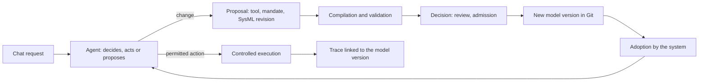

# Assembly at a glance

Assembly runs a system of agents from its SysML v2 model. Agents work, propose
tools, collaborators and rule changes; each change becomes a model revision that
is reviewed and then adopted. You can watch the system take shape and inspect
how it works.

## Two ways to use the workbench

**The user** talks to the system's point of contact. They ask it to read,
monitor or analyse something. They do not need to know SysML: they can see what
the system did, what it is waiting for, what was refused and why.

**The designer** works on the model. They read SysML views, compare revisions,
delegate editing rights and decide on changes. The model is standard textual
SysML v2, versioned in Git: it can be shared, forked and opened in another SysML
tool.

Both look at the same system. The user sees its behaviour, the designer sees its
structure, and traceability connects the two.

## The evolution loop



1. An agent acts within its mandate, as defined by the adopted model.
2. If it lacks a tool, a right or a collaborator, it proposes one.
3. SysML Toolkit compiles and validates the proposal, which is then reviewed.
4. Once admitted, it becomes a model commit; the system adopts it and resumes
   work under its new rules.
5. Each execution records the model version that authorised it.

Several agents can evolve the system at the same time. Their proposals start
from the same base, merge through Git and require explicit reconciliation when
they conflict.

## What the model describes

| In the model                 | In the workbench                                             |
| ---------------------------- | ------------------------------------------------------------ |
| Operators and their mandates | Agents, what they can do and propose                         |
| Entries and inboxes          | Human conversations and exchanges between agents             |
| Tool catalogue and contracts | Tools proposed, tested, admitted and callable                |
| Action flows and guards      | Steps in a conversation turn, a promotion or a plan          |
| Policies                     | Context, memory, skills, budget and result verification      |
| Delegations                  | Who can edit each part of the model, and delegate that right |

The engine executes these constructs when it knows how to interpret them, and
refuses those it cannot yet execute before any effect occurs. Coverage grows as
patterns are implemented.

## APE patterns

The patterns in the _Agentic Process Engineering_ book provide the workbench's
practices: separate proposal, admission and execution
([Proposal–Admission–Execution Separation](evolution/proposition-admission-execution.md)),
verify an effect before closure
([Verified-Effect Closure](execution/cloture-par-effet-verifie.md)), bound a
loop with a budget
([Budget-Bounded Loop](execution/boucle-bornee-par-budget.md)), separate context
sources ([Context Separation](contexte-et-memoire/separation-du-contexte.md)),
govern memory
([Governed Memory Promotion](contexte-et-memoire/promotion-gouvernee-de-la-memoire.md)),
and so on. Each has a definition in the SysML library and a mechanism in the
engine. A system selects those it needs. The
[APE patterns at work](../README.md#ape-patterns-at-work) table lists where each
one acts.

The [code map](../../src/README.md) and [model index](../../models/README.md)
connect each pattern to its sources and implementation.

## Under the hood

```text
.sysml sources (Git)
  → SysML Toolkit (Rust/N-API in a subprocess): parsing, resolution, diagnostics
  → normalisation and executable contract
  → TypeScript runtime: agents, tools, controls, traces
  → Fresh interface: chat, model views, revisions
```

- `src/domain/`: rules and types, without technical dependencies.
- `src/application/`: use cases and ports.
- `src/adapters/`: Toolkit, Git, PostgreSQL, build-cache KV, providers and HTTP.
- `frontend/`: the interface, which reads and issues commands without holding
  authority.

To continue: [start a system](../how-to/atelier/demarrer-un-systeme.md),
[from SysML to execution](execution/sysml-et-execution.md),
[evolve a mandate through chat](../tutorials/evolution/evolution-mandat.md).
